# Beispiele

21 Dokumenttypen, jeweils aus einer kurzen Markdown-Datei erzeugt.
Absender und Bankdaten kommen aus [texify.toml](texify.toml) und müssen
deshalb in keinem Dokument wiederholt werden.

```bash
cd examples
texify build 08-rechnung.md          # -> pdf/08-rechnung.pdf
python ../scripts/build_examples.py  # alle Beispiele + Galerie neu erzeugen
```

**Bewerbungsmappe** aus Deckblatt, Anschreiben und Lebenslauf, mit Lesezeichen:

```bash
texify build 13-deckblatt.md 05-anschreiben.md 11-lebenslauf.md -o pdf/bewerbungsmappe.pdf --bookmarks
```

Ergebnis: [pdf/bewerbungsmappe.pdf](pdf/bewerbungsmappe.pdf)

<!-- Automatisch erzeugt von scripts/build_examples.py – nicht von Hand bearbeiten. -->

|   |   |   |
|---|---|---|
| <a href="pdf/01-bericht.pdf">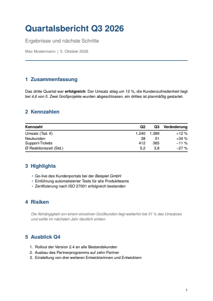</a><br>**Bericht**<br>[`01-bericht.md`](01-bericht.md) · `article` | <a href="pdf/02-anleitung.pdf">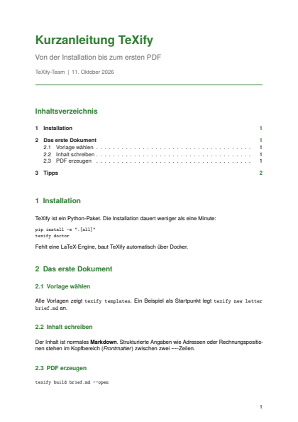</a><br>**Anleitung**<br>[`02-anleitung.md`](02-anleitung.md) · `article` | <a href="pdf/03-lastenheft.pdf">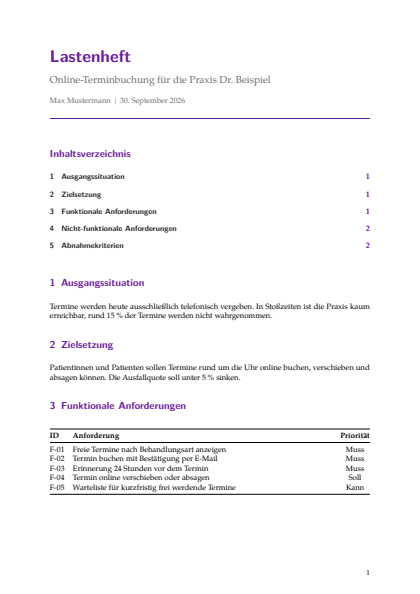</a><br>**Lastenheft**<br>[`03-lastenheft.md`](03-lastenheft.md) · `article` |
| <a href="pdf/04-pressemitteilung.pdf">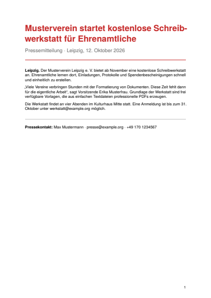</a><br>**Pressemitteilung**<br>[`04-pressemitteilung.md`](04-pressemitteilung.md) · `article` | <a href="pdf/05-anschreiben.pdf">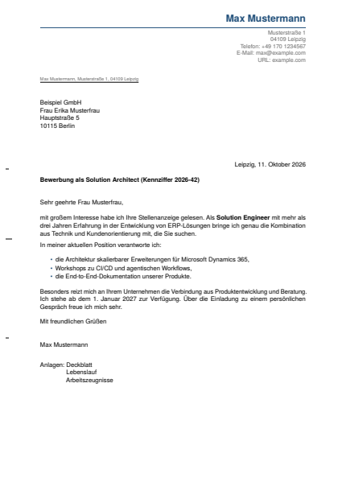</a><br>**Bewerbungsanschreiben**<br>[`05-anschreiben.md`](05-anschreiben.md) · `letter` | <a href="pdf/06-kuendigung.pdf">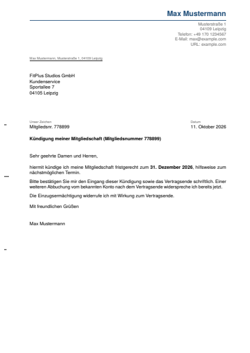</a><br>**Kündigung**<br>[`06-kuendigung.md`](06-kuendigung.md) · `letter` |
| <a href="pdf/07-mahnung.pdf">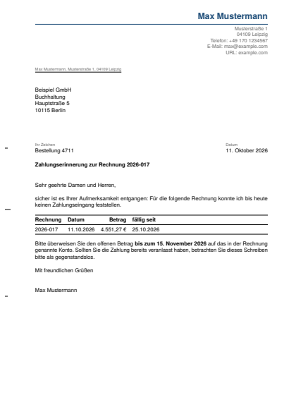</a><br>**Zahlungserinnerung**<br>[`07-mahnung.md`](07-mahnung.md) · `letter` | <a href="pdf/08-rechnung.pdf">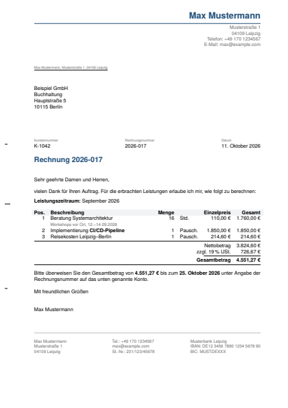</a><br>**Rechnung**<br>[`08-rechnung.md`](08-rechnung.md) · `invoice` | <a href="pdf/09-rechnung-kleinunternehmer.pdf">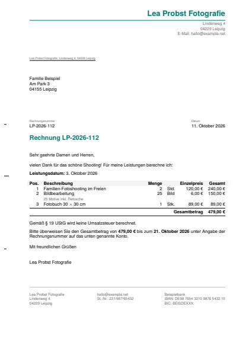</a><br>**Rechnung (Kleinunternehmer)**<br>[`09-rechnung-kleinunternehmer.md`](09-rechnung-kleinunternehmer.md) · `invoice` |
| <a href="pdf/10-angebot.pdf">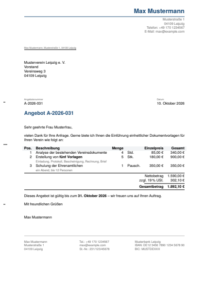</a><br>**Angebot**<br>[`10-angebot.md`](10-angebot.md) · `invoice` | <a href="pdf/11-lebenslauf.pdf">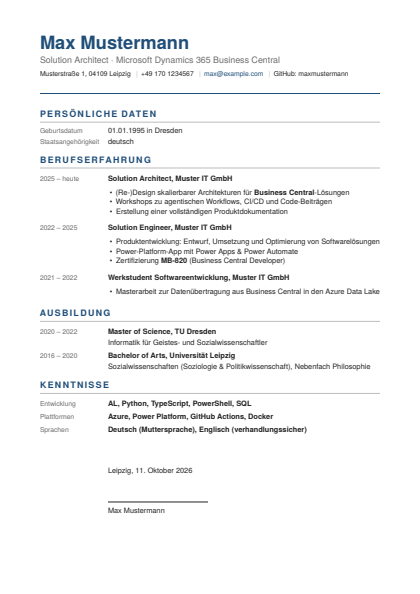</a><br>**Lebenslauf (tabellarisch)**<br>[`11-lebenslauf.md`](11-lebenslauf.md) · `cv` | <a href="pdf/12-cv-english.pdf">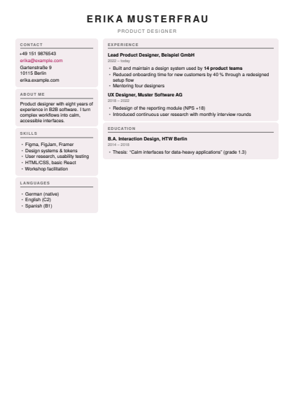</a><br>**CV (modern, English)**<br>[`12-cv-english.md`](12-cv-english.md) · `cv-cards` |
| <a href="pdf/13-deckblatt.pdf">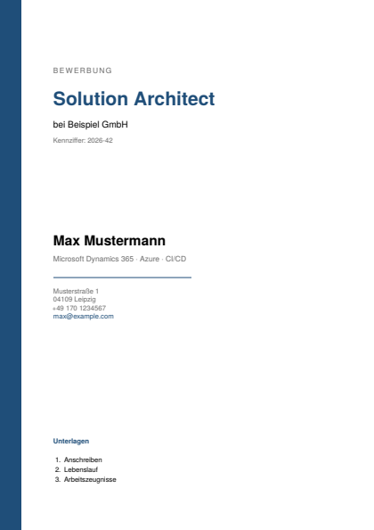</a><br>**Bewerbungs-Deckblatt**<br>[`13-deckblatt.md`](13-deckblatt.md) · `coverpage` | <a href="pdf/14-projektantrag.pdf">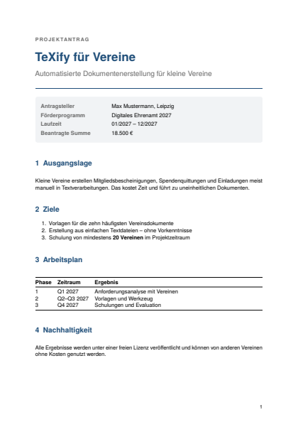</a><br>**Projektantrag**<br>[`14-projektantrag.md`](14-projektantrag.md) · `proposal` | <a href="pdf/15-teilnahmebestaetigung.pdf">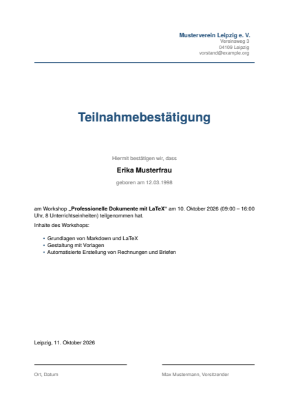</a><br>**Teilnahmebestätigung**<br>[`15-teilnahmebestaetigung.md`](15-teilnahmebestaetigung.md) · `confirmation` |
| <a href="pdf/16-arbeitszeugnis.pdf">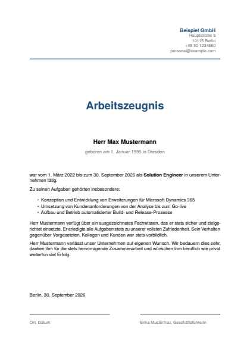</a><br>**Arbeitszeugnis**<br>[`16-arbeitszeugnis.md`](16-arbeitszeugnis.md) · `confirmation` | <a href="pdf/17-vollmacht.pdf">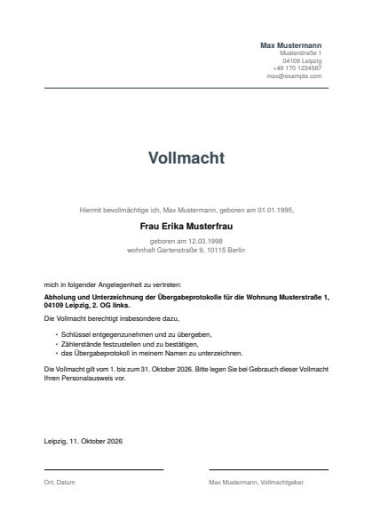</a><br>**Vollmacht**<br>[`17-vollmacht.md`](17-vollmacht.md) · `confirmation` | <a href="pdf/18-protokoll.pdf">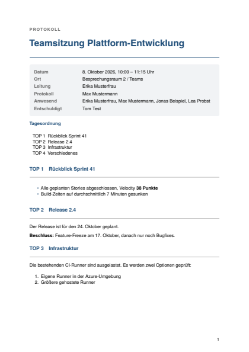</a><br>**Protokoll**<br>[`18-protokoll.md`](18-protokoll.md) · `minutes` |
| <a href="pdf/19-einladung.pdf">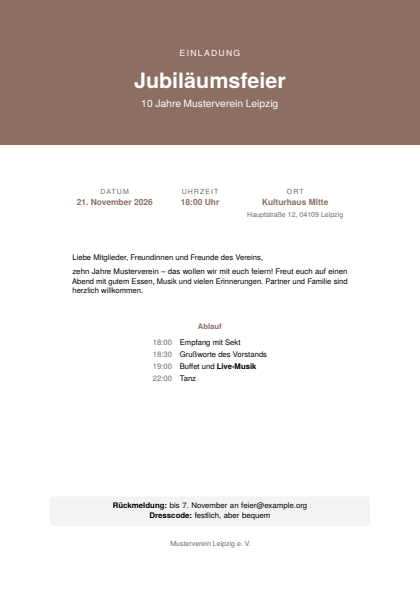</a><br>**Einladung**<br>[`19-einladung.md`](19-einladung.md) · `invitation` | <a href="pdf/20-zertifikat.pdf">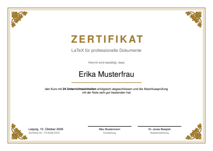</a><br>**Zertifikat**<br>[`20-zertifikat.md`](20-zertifikat.md) · `certificate` | <a href="pdf/21-vertrag.pdf">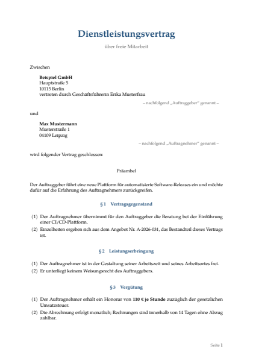</a><br>**Vertrag**<br>[`21-vertrag.md`](21-vertrag.md) · `contract` |

## Übersicht

| Typ | Datei | Template |
|---|---|---|
| Bericht | [01-bericht.md](01-bericht.md) | `article` |
| Anleitung | [02-anleitung.md](02-anleitung.md) | `article` |
| Lastenheft | [03-lastenheft.md](03-lastenheft.md) | `article` |
| Pressemitteilung | [04-pressemitteilung.md](04-pressemitteilung.md) | `article` |
| Bewerbungsanschreiben | [05-anschreiben.md](05-anschreiben.md) | `letter` |
| Kündigung | [06-kuendigung.md](06-kuendigung.md) | `letter` |
| Zahlungserinnerung | [07-mahnung.md](07-mahnung.md) | `letter` |
| Rechnung | [08-rechnung.md](08-rechnung.md) | `invoice` |
| Rechnung (Kleinunternehmer) | [09-rechnung-kleinunternehmer.md](09-rechnung-kleinunternehmer.md) | `invoice` |
| Angebot | [10-angebot.md](10-angebot.md) | `invoice` |
| Lebenslauf (tabellarisch) | [11-lebenslauf.md](11-lebenslauf.md) | `cv` |
| CV (modern, English) | [12-cv-english.md](12-cv-english.md) | `cv-cards` |
| Bewerbungs-Deckblatt | [13-deckblatt.md](13-deckblatt.md) | `coverpage` |
| Projektantrag | [14-projektantrag.md](14-projektantrag.md) | `proposal` |
| Teilnahmebestätigung | [15-teilnahmebestaetigung.md](15-teilnahmebestaetigung.md) | `confirmation` |
| Arbeitszeugnis | [16-arbeitszeugnis.md](16-arbeitszeugnis.md) | `confirmation` |
| Vollmacht | [17-vollmacht.md](17-vollmacht.md) | `confirmation` |
| Protokoll | [18-protokoll.md](18-protokoll.md) | `minutes` |
| Einladung | [19-einladung.md](19-einladung.md) | `invitation` |
| Zertifikat | [20-zertifikat.md](20-zertifikat.md) | `certificate` |
| Vertrag | [21-vertrag.md](21-vertrag.md) | `contract` |
