# Examples

21 document types, each generated from a short Markdown file.
Sender and bank details come from [texify.toml](texify.toml), so no
document has to repeat them.

```bash
cd examples
texify build 08-invoice.md            # -> pdf/08-invoice.pdf
cargo xtask examples                  # rebuild every example + this gallery
```

**Job application bundle** from cover page, cover letter and CV, with bookmarks:

```bash
texify build 13-application-cover.md 05-cover-letter.md 11-cv-classic.md -o pdf/application.pdf --bookmarks
```

Result: [pdf/application.pdf](pdf/application.pdf)

<!-- Generated by `cargo xtask examples` – do not edit by hand. -->

| | | |
|---|---|---|
| <a href="pdf/01-report.pdf">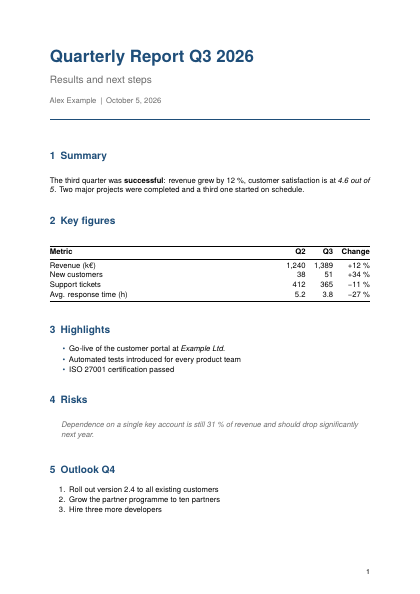</a><br>**Report**<br>[`01-report.md`](01-report.md) · `article` | <a href="pdf/02-how-to-guide.pdf">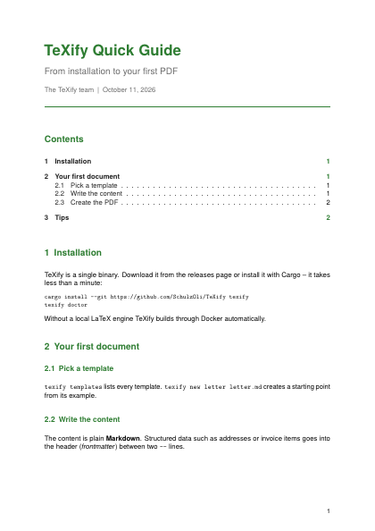</a><br>**How-to guide**<br>[`02-how-to-guide.md`](02-how-to-guide.md) · `article` | <a href="pdf/03-requirements-spec.pdf">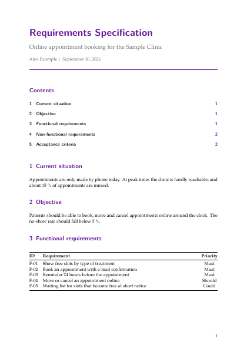</a><br>**Requirements specification**<br>[`03-requirements-spec.md`](03-requirements-spec.md) · `article` |
| <a href="pdf/04-press-release.pdf">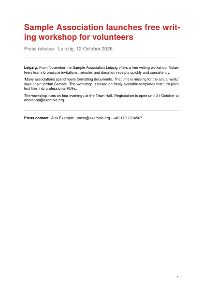</a><br>**Press release**<br>[`04-press-release.md`](04-press-release.md) · `article` | <a href="pdf/05-cover-letter.pdf">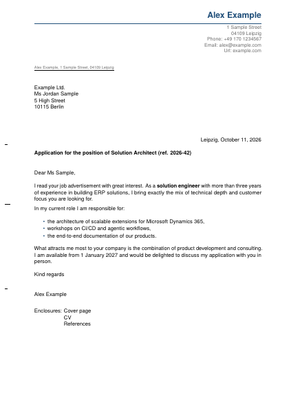</a><br>**Cover letter**<br>[`05-cover-letter.md`](05-cover-letter.md) · `letter` | <a href="pdf/06-cancellation.pdf">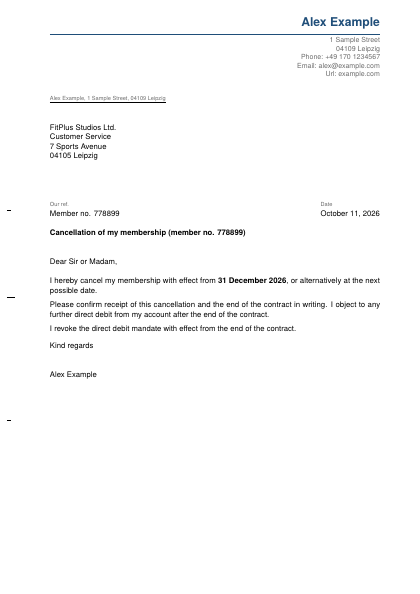</a><br>**Cancellation letter**<br>[`06-cancellation.md`](06-cancellation.md) · `letter` |
| <a href="pdf/07-payment-reminder.pdf">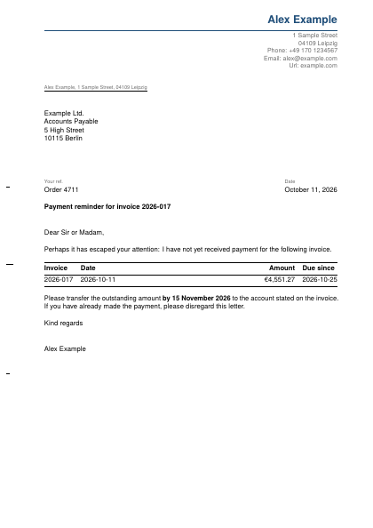</a><br>**Payment reminder**<br>[`07-payment-reminder.md`](07-payment-reminder.md) · `letter` | <a href="pdf/08-invoice.pdf">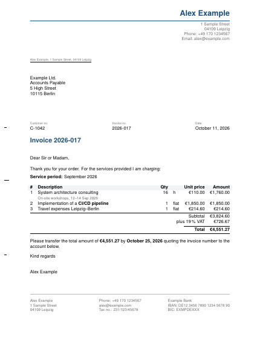</a><br>**Invoice**<br>[`08-invoice.md`](08-invoice.md) · `invoice` | <a href="pdf/09-invoice-small-business.pdf">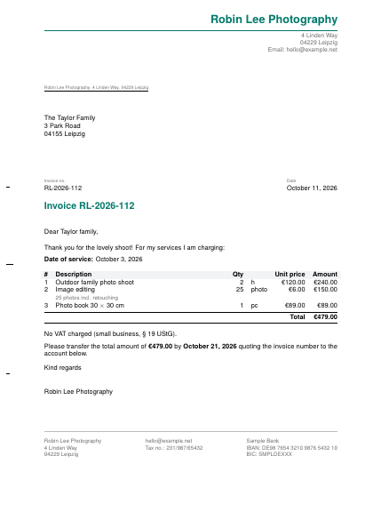</a><br>**Invoice (VAT-exempt small business)**<br>[`09-invoice-small-business.md`](09-invoice-small-business.md) · `invoice` |
| <a href="pdf/10-quote.pdf">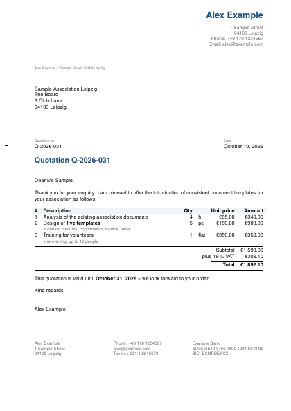</a><br>**Quote**<br>[`10-quote.md`](10-quote.md) · `invoice` | <a href="pdf/11-cv-classic.pdf">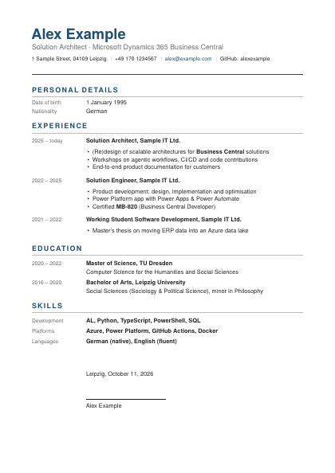</a><br>**CV (classic, tabular)**<br>[`11-cv-classic.md`](11-cv-classic.md) · `cv` | <a href="pdf/12-cv-modern.pdf">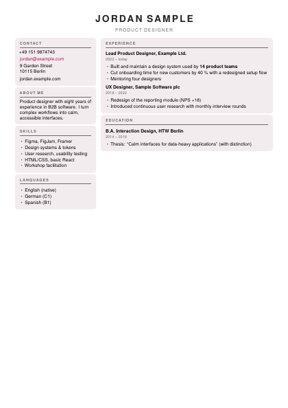</a><br>**CV (modern, cards)**<br>[`12-cv-modern.md`](12-cv-modern.md) · `cv-cards` |
| <a href="pdf/13-application-cover.pdf">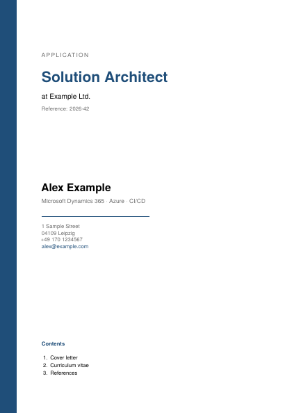</a><br>**Application cover page**<br>[`13-application-cover.md`](13-application-cover.md) · `coverpage` | <a href="pdf/14-project-proposal.pdf">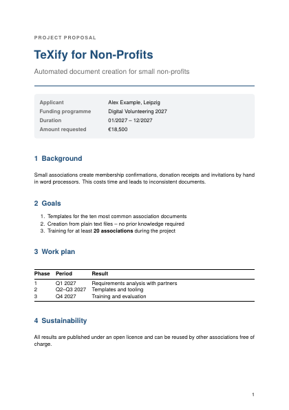</a><br>**Project proposal**<br>[`14-project-proposal.md`](14-project-proposal.md) · `proposal` | <a href="pdf/15-certificate-of-attendance.pdf">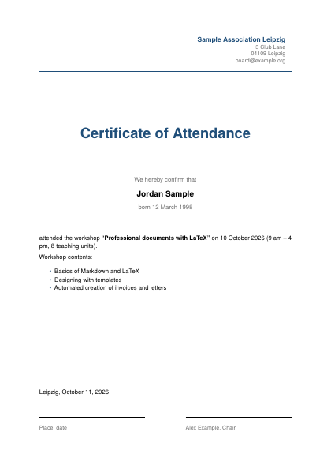</a><br>**Certificate of attendance**<br>[`15-certificate-of-attendance.md`](15-certificate-of-attendance.md) · `confirmation` |
| <a href="pdf/16-employment-reference.pdf">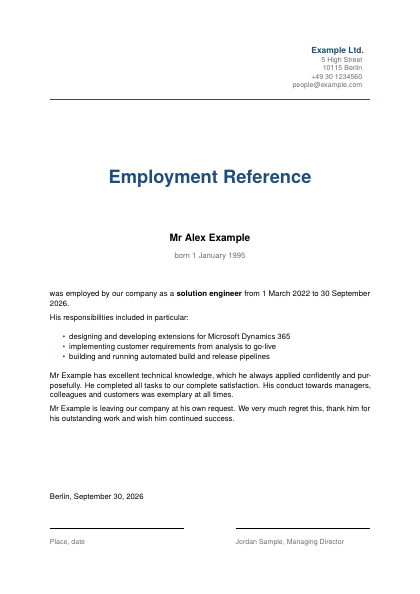</a><br>**Employment reference**<br>[`16-employment-reference.md`](16-employment-reference.md) · `confirmation` | <a href="pdf/17-power-of-attorney.pdf">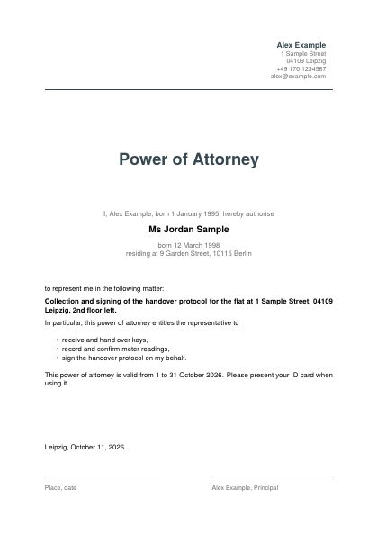</a><br>**Power of attorney**<br>[`17-power-of-attorney.md`](17-power-of-attorney.md) · `confirmation` | <a href="pdf/18-meeting-minutes.pdf">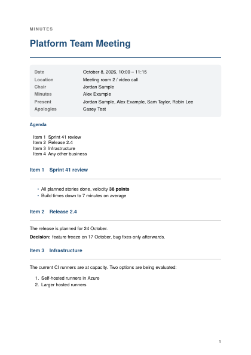</a><br>**Meeting minutes**<br>[`18-meeting-minutes.md`](18-meeting-minutes.md) · `minutes` |
| <a href="pdf/19-invitation.pdf">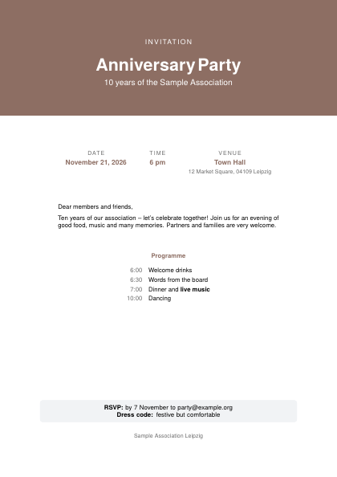</a><br>**Invitation**<br>[`19-invitation.md`](19-invitation.md) · `invitation` | <a href="pdf/20-certificate.pdf"></a><br>**Certificate**<br>[`20-certificate.md`](20-certificate.md) · `certificate` | <a href="pdf/21-service-agreement.pdf">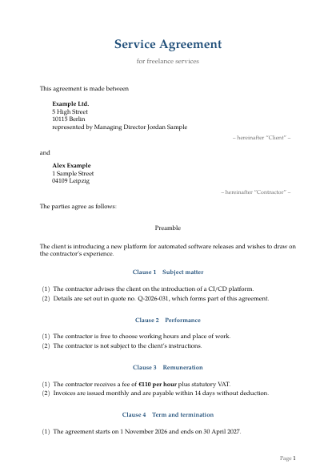</a><br>**Service agreement**<br>[`21-service-agreement.md`](21-service-agreement.md) · `contract` |

## Overview

| Type | File | Template |
|---|---|---|
| Report | [01-report.md](01-report.md) | `article` |
| How-to guide | [02-how-to-guide.md](02-how-to-guide.md) | `article` |
| Requirements specification | [03-requirements-spec.md](03-requirements-spec.md) | `article` |
| Press release | [04-press-release.md](04-press-release.md) | `article` |
| Cover letter | [05-cover-letter.md](05-cover-letter.md) | `letter` |
| Cancellation letter | [06-cancellation.md](06-cancellation.md) | `letter` |
| Payment reminder | [07-payment-reminder.md](07-payment-reminder.md) | `letter` |
| Invoice | [08-invoice.md](08-invoice.md) | `invoice` |
| Invoice (VAT-exempt small business) | [09-invoice-small-business.md](09-invoice-small-business.md) | `invoice` |
| Quote | [10-quote.md](10-quote.md) | `invoice` |
| CV (classic, tabular) | [11-cv-classic.md](11-cv-classic.md) | `cv` |
| CV (modern, cards) | [12-cv-modern.md](12-cv-modern.md) | `cv-cards` |
| Application cover page | [13-application-cover.md](13-application-cover.md) | `coverpage` |
| Project proposal | [14-project-proposal.md](14-project-proposal.md) | `proposal` |
| Certificate of attendance | [15-certificate-of-attendance.md](15-certificate-of-attendance.md) | `confirmation` |
| Employment reference | [16-employment-reference.md](16-employment-reference.md) | `confirmation` |
| Power of attorney | [17-power-of-attorney.md](17-power-of-attorney.md) | `confirmation` |
| Meeting minutes | [18-meeting-minutes.md](18-meeting-minutes.md) | `minutes` |
| Invitation | [19-invitation.md](19-invitation.md) | `invitation` |
| Certificate | [20-certificate.md](20-certificate.md) | `certificate` |
| Service agreement | [21-service-agreement.md](21-service-agreement.md) | `contract` |
